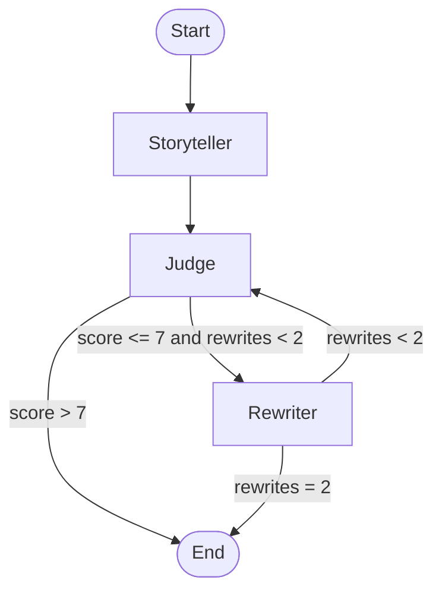

# Story Judge

Story Judge writes a short bedtime story, reviews it, and rewrites it until the review is strong enough. A [LangGraph](https://github.com/langchain-ai/langgraph) loop runs three roles against local or cloud models in [Ollama](https://ollama.com/):

1. **Storyteller** drafts a gentle story for ages 5–10.
2. **Judge** scores that draft from 1 to 10 and returns problems plus suggestions as JSON.
3. **Rewriter** applies the feedback.

The judge sends the story to the rewriter when the score is 7 or lower. The loop stops after two rewrites, or as soon as a draft scores above 7.



## Requirements

- Python 3.13
- [Ollama](https://ollama.com/download) running locally
- The storyteller model pulled, and access to the judge and rewriter models

Default models:

| Role | Model | Notes |
| --- | --- | --- |
| Storyteller | `qwen2.5:1.5b` | Local. Pull it with Ollama. |
| Judge | `gemma4:cloud` | Ollama Cloud. Requires `ollama signin`. |
| Rewriter | `gemma4:cloud` | Ollama Cloud. Requires `ollama signin`. |

Change the names in `.env` if you want different models. Any Ollama model that can follow the prompts will work. The judge must return JSON.

## Setup

From the project folder:

```powershell
python -m venv .venv
.\.venv\Scripts\Activate.ps1
pip install -r requirements.txt
copy .env.example .env
ollama pull qwen2.5:1.5b
```

On macOS or Linux, activate with `source .venv/bin/activate` and copy the example env with `cp .env.example .env`.

LangSmith tracing is optional. To turn it on, set `LANGSMITH_TRACING=true` in `.env` and add your API key from [LangSmith](https://smith.langchain.com/). Leave tracing off if you only want local runs. If your key uses the EU region, set:

```
LANGSMITH_ENDPOINT=https://eu.api.smith.langchain.com
```

## Run

```powershell
python main.py
```

Enter a story topic, for example `a shy fox who helps a lost duck`. Type `exit` or `quit` to stop.

Each run prints the request, the judge's score and notes, the first draft, and the rewritten story when one was needed. The first time you run it, the app also tries to save a `graph.png` diagram next to `main.py`. That file is generated output and is listed in `.gitignore`.

## Configuration

| Variable | Default | Purpose |
| --- | --- | --- |
| `STORYTELLER_MODEL` | `qwen2.5:1.5b` | Model that writes the first draft |
| `JUDGE_MODEL` | `gemma4:cloud` | Model that scores the story |
| `REWRITER_MODEL` | `gemma4:cloud` | Model that rewrites from the judge's notes |
| `LANGSMITH_TRACING` | `false` | Send traces to LangSmith when `true` |
| `LANGSMITH_API_KEY` | empty | LangSmith API key |
| `LANGSMITH_PROJECT` | `Story_Judge` | LangSmith project name |
| `LANGSMITH_ENDPOINT` | `https://api.smith.langchain.com` | LangSmith API host |

The pass mark (`7`) and the rewrite cap (`2`) live in `main.py` as `PASS_SCORE` and `MAX_REWRITES`.

## Project layout

```
Story_Judge/
├── main.py            # graph, prompts, and command-line loop
├── requirements.txt   # pinned Python dependencies
├── .env.example       # environment template, safe to commit
├── .gitignore
├── LICENSE
└── README.md
```

## License

MIT. See [LICENSE](LICENSE). Replace the copyright line if you want your own name on it.
